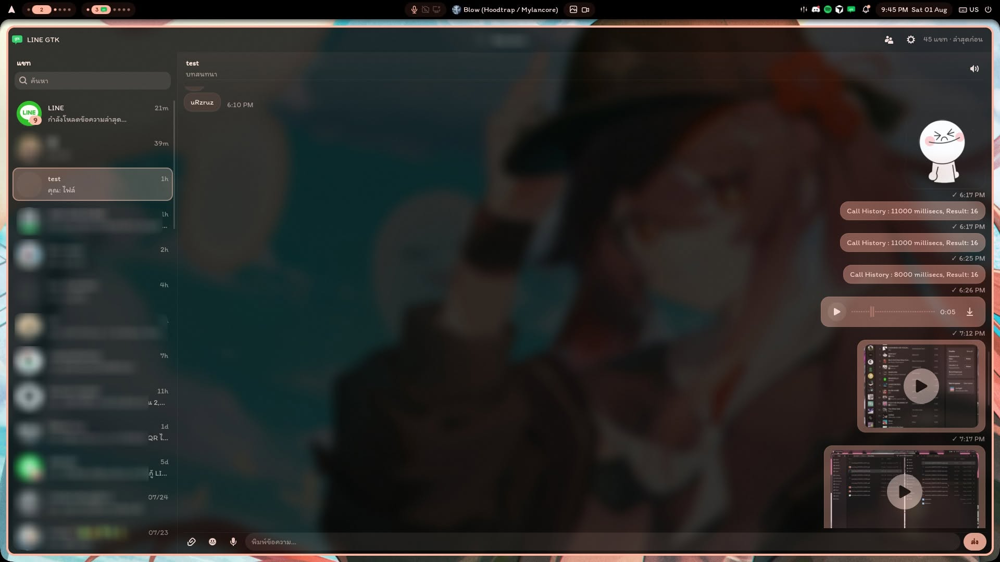

# Line-GTK

Unofficial native LINE client for Linux, with a GTK4/Libadwaita interface and a Deno protocol sidecar powered by [linejs](https://github.com/evex-dev/linejs).

**README:** English · [Tiếng Việt](README.vi.md) · [日本語](README.ja.md)

> The `personal/features` branch is for personal feature development and is separate from `main`, which is used for upstream pull requests. It integrates Japanese UI and font support, message decryption, group information, and email login changes.



## Features

- [x] QR login as an additional device; email and password login with phone verification when needed
- [x] Chats, messages, stickers, friends, photos, videos, voice messages, and files
- [x] Replies, unsend, reactions, Unicode emoji, and received LINE emoji
- [x] Chat filters and search; hide, pin, and block contacts
- [x] Group event notices and sender names
- [x] Albums, original photo downloads, and in-app image, video, PDF, and text viewers
- [x] Paste and drag-and-drop attachments
- [x] Sticker notification previews, unread sync, and recovery after sleep or network loss
- [x] Downloads, tray, themes, Discord RPC, and Vietnamese (app default), Thai, English, and Japanese UI
- [ ] Voice calls (work in progress)
- [ ] Account switcher

### Read receipts and unread state

Turn on **Do not mark as read** at the top of the window to stop read receipts from this app. The setting survives restarts, and unread badges remain. Turning it off does not mark everything read at once: receipts resume through normal activity, such as opening a chat. In an already open chat at the latest messages, clicking the conversation or composer, typing, or scrolling may send a receipt. Reading older history, the global pause, or a per-contact pause prevents this. Receipts already sent or sent by other devices are unaffected.

To pause one contact, right-click their chat and choose **Do not mark this friend as read**. Their avatar gains an eye-off mark. Opening the chat or receiving messages leaves them unread. Use the same menu to resume; resuming alone sends nothing. Per-contact settings are stored per account. Resuming a contact has no effect while the global pause is on or automatic read receipts are off.

Use **Mark read up to here** at the top of a chat or in its context menu to mark only messages received so far. Pause settings stay on, so later messages remain unread. Only a successfully sent range updates the unread count; new messages arriving during the request or a failed request cannot incorrectly clear it. Read notifications from another device update the chat, open conversation, and tray even while local receipts are paused. This synchronization never sends a receipt and checks the server when needed to avoid clearing newer unread messages.

### Messages and chat controls

Click the arrow beside a message or choose **Reply** from its context menu to quote it. Cancel with × or Esc; switching chats clears the quote. Use the smile button or **React** menu to pick one of six standard reactions, a recent LINE emoji, or an emoji from an owned set. Click a reaction under a bubble to toggle yours; right-click or long-press it to see who reacted. Reactions from other devices are stored per account. The six standard reactions use LINE icons in `assets/reactions`. LINE may reject sending an emoji reaction, depending on conditions such as ownership; the official desktop client only displays received LINE emoji reactions.

Right-click a contact chat and confirm **Block** to block that person on LINE. Unblock from the same menu or **Settings → Features → Blocked users**. History remains, the list shows a blocked mark, and the one-to-one composer and send requests are disabled. Their group messages still appear. The server block list refreshes at startup, on resume, and after changes from another device. A failed request retains the last confirmed state. Blocking does not change read-pause settings or send a read receipt. Group behavior follows [LINE's help](https://help2.line.me/line/smartphone?contentId=200002013&lang=ja).

Right-click a friend chat to pin or unpin it. Pinned chats appear first; each group remains sorted by recency. Search, category, and hidden-chat filters still apply. Pins are stored per account on this computer, and pinning sends no read receipt. Right-click a chat to hide it from this computer's chat list, search results, and recent tray chats. Restore it under **Settings → Features → Hidden chats**. History is retained, and hiding or restoring sends no receipt. Hiding the open chat clears the selection. Hidden state persists through new messages and restarts per account, but does not sync to other devices; notification settings are independent.

Use **Unsend** on one of your messages and confirm to request removal on LINE. The app replaces its content only after LINE confirms success; a failure leaves the original. LINE decides eligibility and time limits and shows its standard notice to recipients. Unsend events from other devices are stored per account, so reloading history or restarting does not restore removed content. Already downloaded photos and files are not deleted.

The sticker picker shows a 160 px still preview on hover using cached assets. To download a pack as local images, paste its LINE STORE link or numeric pack ID into the picker and choose **Download**. **Browse LINE STORE** opens the catalog in your browser. Downloaded packs are marked **Images**. Clicking an item sends it immediately with the last size and background-removal settings used for that sticker; new stickers default to **Large** with **Auto-remove background** enabled. Right-click an item (or press Shift+F10) and choose **Edit size and background…** for a preview with **Small**, **Medium**, **Large**, and **Original size** options. Settings are remembered separately for each sticker across restarts when you send from the editor. Automatic removal handles flat backgrounds connected to the image edges and preserves enclosed artwork; turn it off if the preview removes wanted details. Smaller sizes center the artwork on a transparent canvas to reduce its relative display size. Official LINE controls the final photo rendering and may still show a viewer background. Choose **Send** in the editor to upload the edited static PNG as a normal photo and remember its settings. Originals are retained, and packs and PNGs are cached across restarts; unavailable downloads can be retried by importing the link again.

The composer emoji button inserts Unicode emoji as text at the cursor, using the system emoji font (`noto-fonts-emoji` on Arch). Received LINE emoji display as still images inline, with up to four background downloads into the media cache. If an image is unavailable, its alternative text remains; quotes and chat previews also show alternative text. Sending owned LINE emoji and animated LINE emoji playback are not supported.

### Groups, notifications, and recovery

Group invitation, join, leave, and removal events appear as named notices, including events involving multiple members. Names load in the background. Events received by this computer are stored per account and interleaved with messages by time after reopening or restarting. Limits are 500 events per chat and 5,000 per account; clearing the message cache removes them. Notices cannot be replied to and their IDs are never used for read receipts. Historical group events are unavailable from the message history API, so events missed while the app was closed or disconnected appear only if LINE redelivers them. Group and multi-person bubbles show sender names, including members who are not friends, and update names and quoted sender names after background lookup.

Group notifications show **Sender (Group)** for text, photos, and stickers. Name lookup waits up to 1.2 seconds, then uses a distinct temporary member label if needed and silently updates the same notification later. Sticker notifications show a still image when the notification server supports body images. Image lookup also waits up to 1.2 seconds; a text notification may appear first and be silently updated. A dismissed notification does not reopen. Other servers use an image hint and sticker icon, with text as fallback. Notification images are transparent PNGs up to 200 × 100 pixels and are removed with the sticker cache. Clicking a notification opens the chat; mute settings still apply.

On resume from sleep, the app reconnects its receive stream after two seconds using the saved session, refreshes the chat list and latest 80 messages of the open chat, and merges them without duplicates. Drafts, quotes, scroll position, hidden and pinned chats, and read-pause settings remain. Refresh itself sends no receipt. Pending outgoing bubbles merge after sending finishes. If disconnected, the current view remains and retries occur after 3, 10, and 30 seconds. A **Retry** action appears if needed, and recovery also runs when the network returns. The app uses logind resume notifications, with periodic timing as fallback. Chat previews update when messages load; background loading processes two chats at a time and falls back to **Tap to open** when the latest message is unavailable.

### Media and albums

Click a video thumbnail's play button for a viewer with playback, position, elapsed and total time, and volume controls. Replay after completion, save the video itself, or stop playback by closing the viewer. Playback requires a GTK media backend and suitable codecs. If it fails, use **Retry**, **Open in another app**, or download. If LINE no longer provides the original, the app shows an error instead of saving its thumbnail as a video. Album videos and animated sticker previews are outside the current feature set.

Use **Album** at the top of a chat to open its albums, or **All chats** for the full list. With no chat selected, the full list appears by default. Open a photo for a larger view and save its original from the photo or image viewer. Existing download location and dialog settings apply; normal saving does not overwrite a same-named file. Originals load 12 at a time, with up to three concurrent downloads, and are reused from the media cache. JPEG, PNG, GIF, and WebP are supported up to 50 MB per original. Album videos are marked unsupported; creating albums or adding and deleting photos is unavailable. Use **Retry** after a failed download or refresh stale album information.

## Requirements

Email login authenticates this client as an additional PC device and may require a phone verification code. Normally the app restores a session using PC credentials. Enable **Save login details and sign in automatically at startup** to save email and password in the OS keyring after successful login. You can add, change, or delete them under **Settings → Account → Automatic sign-in at startup**.

Automatic sign-in runs once at startup. It prefers a saved session and tries email login only if that session is missing or invalid. Temporary network errors do not trigger password login, and a later disconnection caused by login from another PC does not trigger automatic re-login. Required phone verification is shown; incorrect credentials return to manual login. Credentials are stored in a Secret Service-compatible keyring, such as GNOME Keyring, never in config files or command arguments. A keyring failure disables automatic sign-in or returns to manual login. Unlocking the keyring may be required. Removing credentials or logging out disables automatic sign-in and deletes saved credentials. Use QR login for the experimental voice-call feature.

| Dependency | Notes |
| --- | --- |
| Rust | Stable toolchain |
| GTK4 + Libadwaita | GTK4 4.14+ and Libadwaita 1.5+; `pacman -S gtk4 libadwaita` on Arch |
| Deno | Deno 2; build-time protocol compiler; source runs use `deno` or `DENO` |
| Python 3 | Dependency verification and package smoke tests |
| ffmpeg / ffprobe | Voice recording and video thumbnails |
| libsecret (`secret-tool`) + Secret Service | Required for automatic email sign-in |
| Optional | `pdftoppm`, `pdftotext` for PDF previews |

Wayland and X11 both work. Testing has mainly been on Arch-based desktops.

## Install

### Arch / AUR

```bash
# Development snapshot
yay -S line-gtk-git

# Tagged release
yay -S line-gtk
```

### Flatpak bundle

```bash
flatpak install --user ./line-gtk-0.1.2-x86_64.flatpak
flatpak run dev.linegtk.LineGtk
```

## Build and run

Vietnamese and English use `Noto Sans` by default, including as fallback for custom chat and composer fonts. Install `noto-fonts` on Arch Linux. Existing Vietnamese settings using the old `Noto Sans Thai` default migrate automatically; custom fonts and an empty system-font setting are preserved. Selecting Japanese uses `Noto Sans CJK JP` with the default font; custom fonts are retained. Install `noto-fonts-cjk` on Arch Linux for Japanese.

```bash
git clone https://github.com/MidnightTale/Line-GTK.git
cd Line-GTK
cargo build --release
./scripts/build-sidecar.sh
LINE_GTK_ROOT="$PWD" ./target/release/line-gtk
```

Builds automatically download checksum-pinned libraries, including linejs, from GitHub into the ignored `protocol/vendor/deps` directory. Builds do not contact JSR. Version pins, the source manifest, and `protocol/deno.lock` remain committed. The first build needs GitHub, the npm registry, and the Deno compiler runtime. Once cached, use `DENO_OFFLINE=1 ./scripts/build-sidecar.sh` to prevent dependency downloads. See the [dependency and connection recovery notes](docs/protocol-reliability.md).

## Development checks

```bash
cargo fmt --all -- --check
cargo clippy --all-targets --all-features -- -D warnings
cargo test --all-targets --all-features
deno task --config protocol/deno.json check
```

## Fork integration

See the [upstream change list](docs/upstream-changes.md) for added features,
protocol and packaging impacts, validation results, and remaining limitations.

This branch integrates documented changes from [shirafukayayoi/Line-GTK](https://github.com/shirafukayayoi/Line-GTK) through `personal/features` commit `0907007`, while keeping Vietnamese as the app's default language. See the [Vietnamese integration notes](docs/fork-shirafukayayoi.md) for features and limits.

## Message decryption and group information

Line-GTK uses linejs 3.5.0 to address message bodies appearing as `(none)`. If an earlier login saved the wrong encryption key, use the key refresh button under **Settings → Account** or on a decryption-failed bubble to reauthorize with a phone QR scan. Existing private keys are kept, and the correct key generation is retrieved from the phone. Group information loads in batches; names and images are stored for later launches.

## Warning

This is an unofficial client. Using it may violate LINE's Terms of Service. Prefer a secondary account or device session. LINE login or encryption changes may break the client.

## Acknowledgments

Protocol and end-to-end encryption access LINE through [linejs](https://github.com/evex-dev/linejs) by [evex-dev](https://github.com/evex-dev). This app is a GTK frontend around that library and is not affiliated with LINE Corporation or evex-dev.

## License

[GPL-3.0-or-later](LICENSE)
